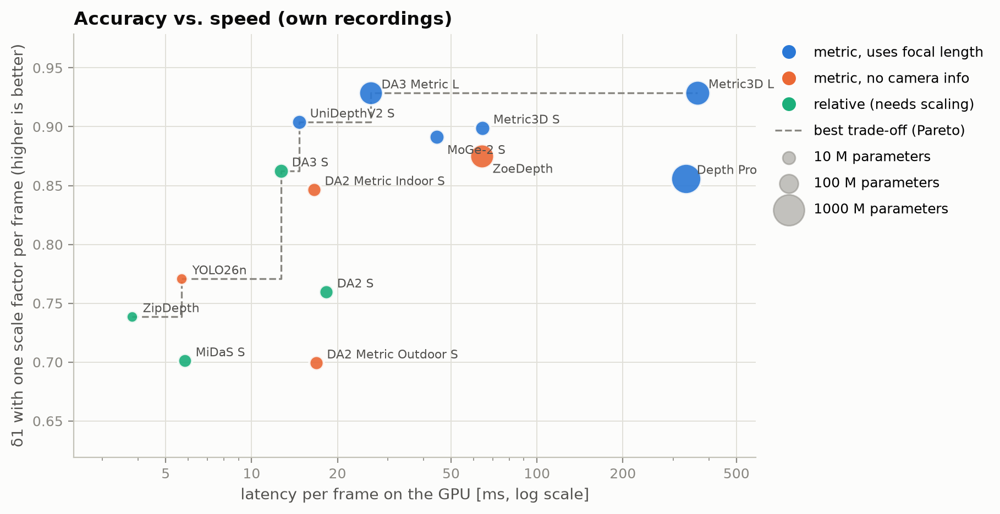
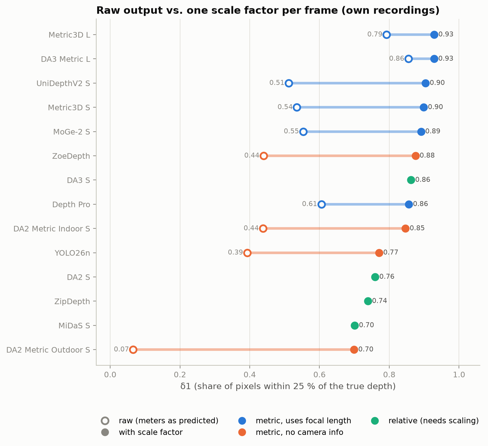
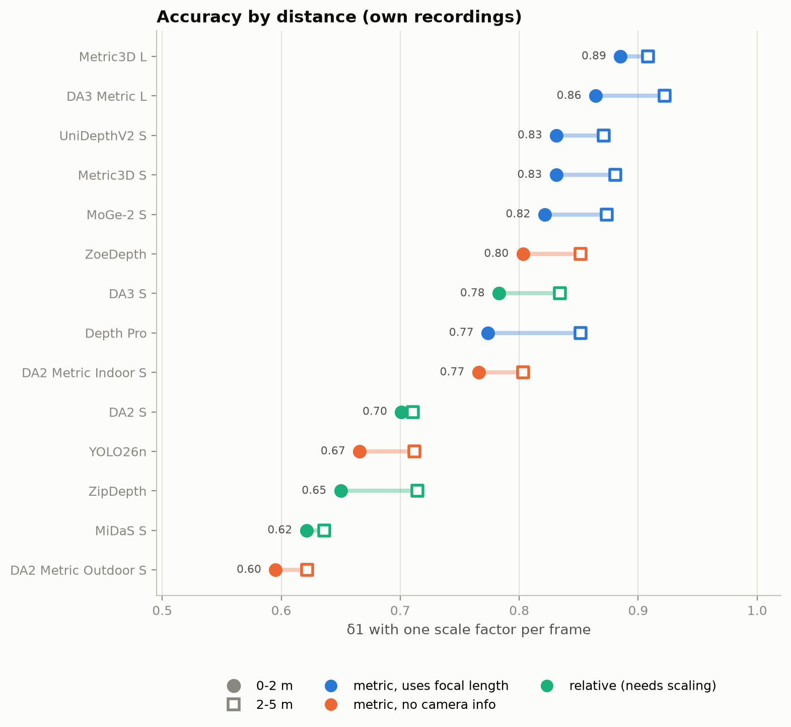
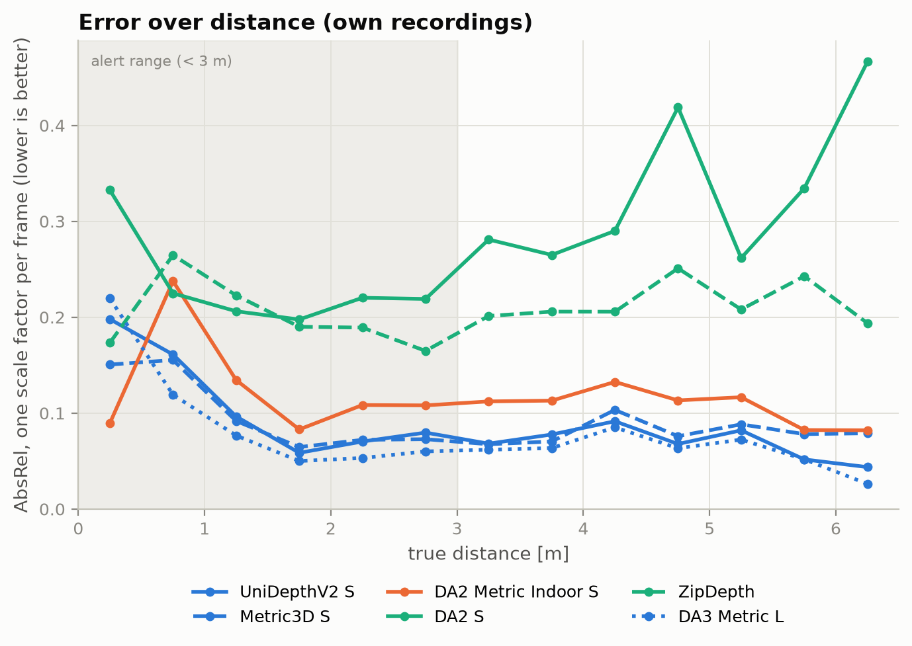
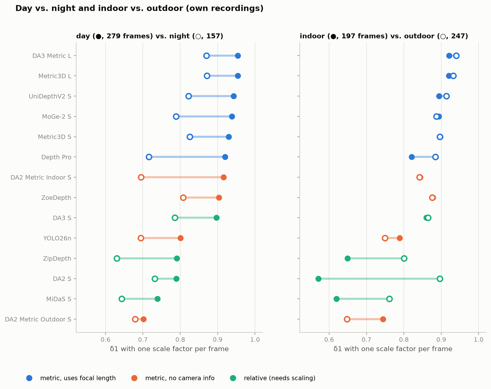
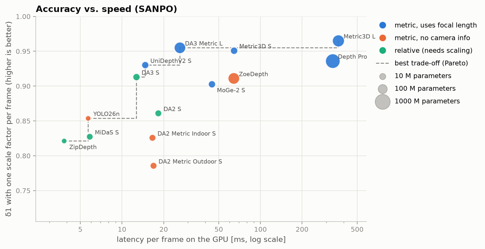
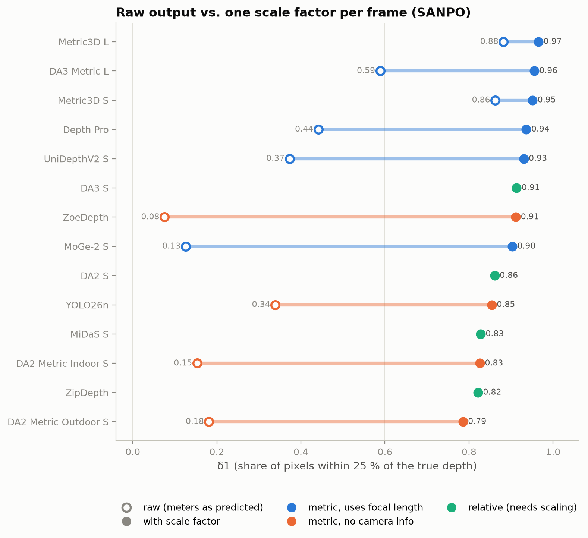
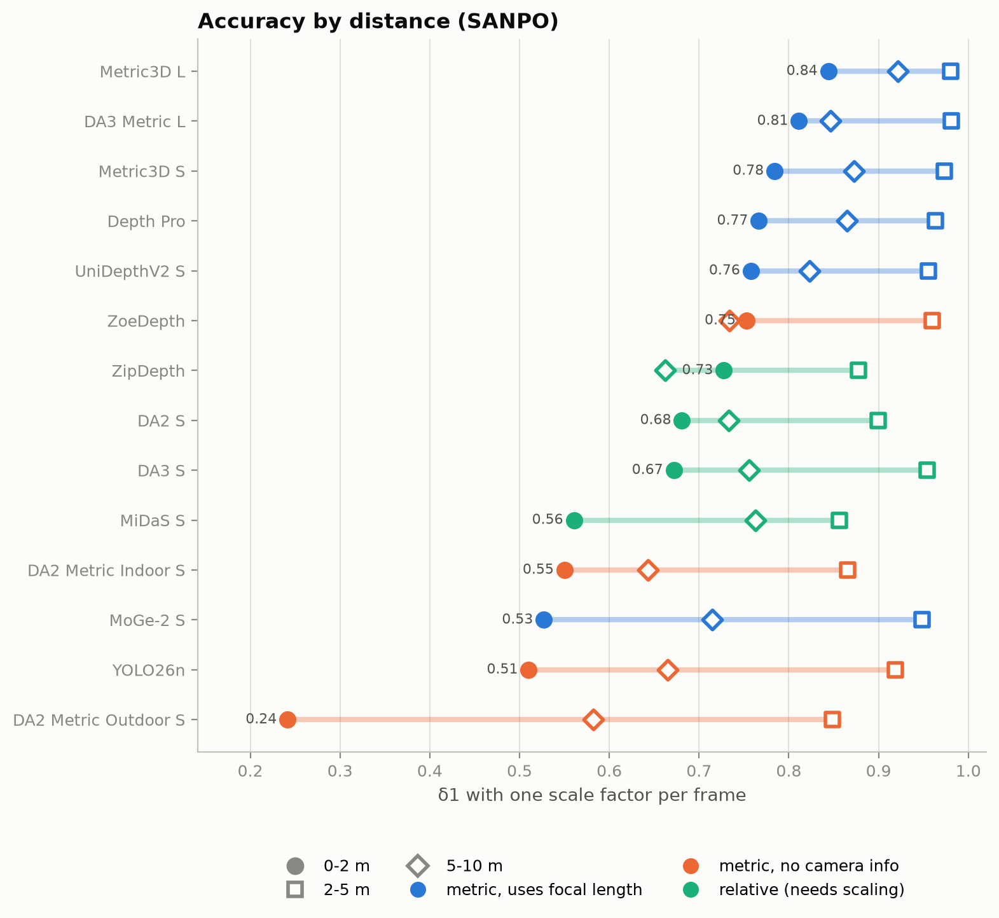
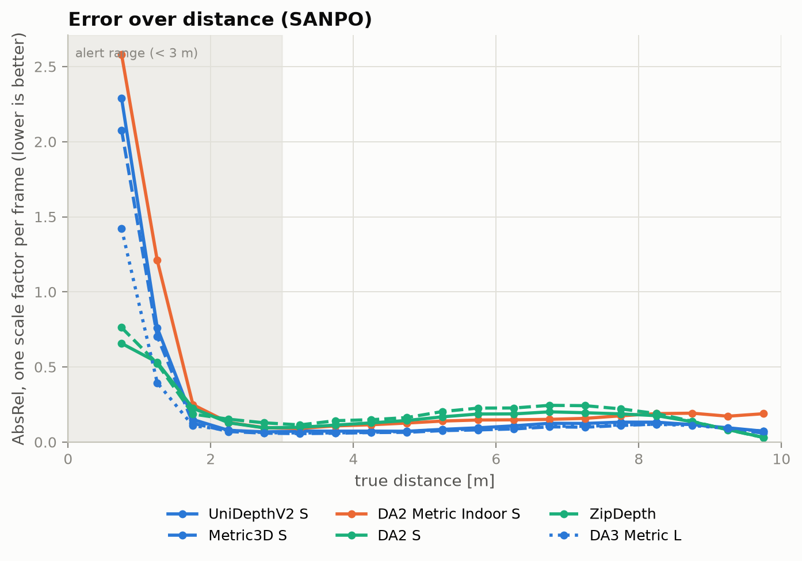

# Blind Spot depth evaluation: m1_full

Date 2026-11-23 20:54, device `cuda` (NVIDIA GeForce RTX 5070 Ti), git `f8fbaff`, Python 3.14.10. Models: `all`.

## Data

- **sanpo**: 45 frames (G-nTeUtNsczDQJrPs4YwVr-yacG96VGn, Mg1c9D4qOCWdYKaOTRlLFpLllUBP_kXh, YnCjnEzv2rFXfyDKwJNehsHg9_l8cPDs)
- **iphone**: 483 frames (in_corridor_artificial_furniture-step_01, in_corridor_day_furniture-step_02, in_corridor_day_wall_01, in_corridor_night_furniture-step_01, in_corridor_night_wall_01, in_room_day_furniture_01, out_terrace_day_furniture_01, out_terrace_day_plant-furniture_01, out_terrace_day_plant-wall_01, out_terrace_day_plant-wall_02, out_terrace_night_furniture_01, out_terrace_night_plant-furniture_01, out_terrace_night_plant-wall_01, trans_door_day_door_01)
- Annotated frames (obstacles): 0

## Models and performance

| model | name | kind | uses K | status | params [M] | load [s] | mean [ms] | p95 [ms] | FPS | peak mem [MiB] | device |
|---|---|---|---|---|---|---|---|---|---|---|---|
| midas_s | MiDaS v2.1 Small | relative | no | cached | 21.321 | 1.250 | 5.840 | 7.902 | 171.228 | 114.194 | cuda |
| da2_s | Depth Anything V2 Small | relative | no | cached | 24.785 | 0.805 | 18.290 | 27.286 | 54.673 | 399.261 | cuda |
| da2m_in_s | Depth Anything V2 Metric Indoor Small | metric | no | cached | 24.785 | 0.400 | 16.554 | 24.022 | 60.409 | 399.261 | cuda |
| da2m_out_s | Depth Anything V2 Metric Outdoor Small | metric | no | cached | 24.785 | 0.377 | 16.845 | 23.872 | 59.364 | 399.261 | cuda |
| m3d_s | Metric3D v2 ViT-S | metric | yes | cached | 37.495 | 0.340 | 64.506 | 67.398 | 15.503 | 699.942 | cuda |
| yolo26n | YOLO26n-Depth | metric | no | cached | 6.356 | 0.049 | 5.687 | 6.950 | 175.826 | 147.844 | cuda |
| zipdepth | ZipDepth Base | relative | no | cached | 6.144 | 0.072 | 3.815 | 6.200 | 262.133 | 98.094 | cuda |
| moge2_s | MoGe-2 ViT-S | metric | yes | cached | 35.104 | 0.901 | 44.479 | 46.047 | 22.482 | 1158.092 | cuda |
| unidepth2_s | UniDepthV2 ViT-S | metric | yes | cached | 34.184 | 1.955 | 14.705 | 19.069 | 68.004 | 596.002 | cuda |
| depthpro | Depth Pro | metric | yes | cached | 951.991 | 1.232 | 333.088 | 360.367 | 3.002 | 3766.715 | cuda |
| da3m_l | Depth Anything 3 Metric Large | metric | yes | cached | 334.171 | 2.816 | 26.156 | 27.778 | 38.232 | 1616.809 | cuda |
| da3_s | Depth Anything 3 Small | relative | no | cached | 34.299 | 0.537 | 12.701 | 13.957 | 78.735 | 268.891 | cuda |
| zoedepth | ZoeDepth NYU+KITTI | metric | no | cached | 345.073 | 0.948 | 64.128 | 112.227 | 15.594 | 2599.934 | cuda |
| m3d_l | Metric3D v2 ViT-L | metric | yes | cached | 411.942 | 1.889 | 365.903 | 385.511 | 2.733 | 3046.081 | cuda |

## Notes

- **Alignment.** `raw` is the prediction as it is (metric models only). `median` (one scale per image) and `affine` (scale and shift in disparity, least squares per image) use the ground truth: they are an **oracle upper bound**, not what the system can do at run time. They make relative models (MiDaS, DA2, ZipDepth) comparable with metric ones. Headline numbers use `raw` for metric and `affine` for relative models (they predict disparity up to scale and shift, so one scale factor cannot fit them).
- **Metrics.** Mean over frames of AbsRel, RMSE (m) and δ1 (share of pixels with max(p/g, g/p) < 1.25), per reference depth range (0-2, 2-5, 5-10 m and all up to 10 m). Frames without valid pixels in a range are left out of that range. After alignment, predictions are clipped to [0.001 m, 10 m] (standard NYU/KITTI protocol), so a few pixels predicted hundreds of meters away cannot dominate a frame.
- **Latency** is end to end per frame (pre-processing, network, post-processing to a NumPy array), after warm-up runs that are not timed; the device is synchronized before the timer stops. Peak memory is the exact CUDA peak of tensor memory, a sampled value on MPS and not available on the CPU (process RSS is in the JSON). Load time includes downloading the weights if they were not cached yet. Performance numbers come from the run that filled the prediction cache (see the device column); rerun with `--recompute` for fresh timings.
- **iPhone ground truth** is LiDAR (ARKit, 256x192, only confidence 2 kept). It is unreliable on glass and other reflective surfaces, at night and beyond about 5 m; treat the 5-10 m range and the glass, night and backlight tags with care.
- **SANPO ground truth** is dense stereo depth (CREStereo) that starts at about 2 m, so the 0-2 m range is empty there; the near range is only measured on our own recordings.

## Results: iphone

### Headline (metric: raw, relative: affine)

| model | alignment | AbsRel 0-2 | AbsRel 2-5 | AbsRel 5-10 | AbsRel all | δ1 0-2 | δ1 2-5 | δ1 5-10 | δ1 all | RMSE all [m] | frames |
|---|---|---|---|---|---|---|---|---|---|---|---|
| midas_s | affine (oracle) | 0.154 | 0.145 | 0.338 | 0.123 | 0.815 | 0.749 | 0.436 | 0.840 | 0.369 | 474 |
| da2_s | affine (oracle) | 0.086 | 0.090 | 0.305 | 0.071 | 0.932 | 0.893 | 0.593 | 0.938 | 0.226 | 474 |
| da2m_in_s | raw | 0.375 | 0.297 | 0.184 | 0.331 | 0.361 | 0.530 | 0.782 | 0.438 | 0.704 | 474 |
| da2m_out_s | raw | 2.498 | 1.363 | 0.805 | 1.944 | 0.001 | 0.132 | 0.057 | 0.066 | 3.540 | 474 |
| m3d_s | raw | 0.330 | 0.234 | 0.154 | 0.277 | 0.500 | 0.596 | 0.838 | 0.535 | 0.592 | 474 |
| yolo26n | raw | 0.547 | 0.323 | 0.288 | 0.432 | 0.298 | 0.495 | 0.513 | 0.393 | 0.890 | 474 |
| zipdepth | affine (oracle) | 0.126 | 0.123 | 0.288 | 0.103 | 0.850 | 0.814 | 0.520 | 0.877 | 0.298 | 474 |
| moge2_s | raw | 0.317 | 0.263 | 0.153 | 0.275 | 0.512 | 0.574 | 0.838 | 0.553 | 0.615 | 474 |
| unidepth2_s | raw | 0.422 | 0.272 | 0.164 | 0.338 | 0.457 | 0.587 | 0.779 | 0.512 | 0.708 | 474 |
| depthpro | raw | 0.408 | 0.259 | 0.213 | 0.336 | 0.580 | 0.603 | 0.621 | 0.605 | 0.711 | 474 |
| da3m_l | raw | 0.164 | 0.101 | 0.080 | 0.115 | 0.800 | 0.867 | 0.912 | 0.855 | 0.259 | 474 |
| da3_s | affine (oracle) | 0.105 | 0.103 | 0.227 | 0.084 | 0.891 | 0.859 | 0.636 | 0.913 | 0.251 | 474 |
| zoedepth | raw | 0.841 | 0.801 | 0.425 | 0.807 | 0.476 | 0.418 | 0.306 | 0.440 | 1.758 | 474 |
| m3d_l | raw | 0.218 | 0.156 | 0.084 | 0.176 | 0.732 | 0.822 | 0.950 | 0.792 | 0.399 | 474 |

### Alignment raw

| model | alignment | AbsRel 0-2 | AbsRel 2-5 | AbsRel 5-10 | AbsRel all | δ1 0-2 | δ1 2-5 | δ1 5-10 | δ1 all | RMSE all [m] | frames |
|---|---|---|---|---|---|---|---|---|---|---|---|
| da2m_in_s | raw | 0.375 | 0.297 | 0.184 | 0.331 | 0.361 | 0.530 | 0.782 | 0.438 | 0.704 | 474 |
| da2m_out_s | raw | 2.498 | 1.363 | 0.805 | 1.944 | 0.001 | 0.132 | 0.057 | 0.066 | 3.540 | 474 |
| m3d_s | raw | 0.330 | 0.234 | 0.154 | 0.277 | 0.500 | 0.596 | 0.838 | 0.535 | 0.592 | 474 |
| yolo26n | raw | 0.547 | 0.323 | 0.288 | 0.432 | 0.298 | 0.495 | 0.513 | 0.393 | 0.890 | 474 |
| moge2_s | raw | 0.317 | 0.263 | 0.153 | 0.275 | 0.512 | 0.574 | 0.838 | 0.553 | 0.615 | 474 |
| unidepth2_s | raw | 0.422 | 0.272 | 0.164 | 0.338 | 0.457 | 0.587 | 0.779 | 0.512 | 0.708 | 474 |
| depthpro | raw | 0.408 | 0.259 | 0.213 | 0.336 | 0.580 | 0.603 | 0.621 | 0.605 | 0.711 | 474 |
| da3m_l | raw | 0.164 | 0.101 | 0.080 | 0.115 | 0.800 | 0.867 | 0.912 | 0.855 | 0.259 | 474 |
| zoedepth | raw | 0.841 | 0.801 | 0.425 | 0.807 | 0.476 | 0.418 | 0.306 | 0.440 | 1.758 | 474 |
| m3d_l | raw | 0.218 | 0.156 | 0.084 | 0.176 | 0.732 | 0.822 | 0.950 | 0.792 | 0.399 | 474 |

### Alignment median (oracle)

| model | alignment | AbsRel 0-2 | AbsRel 2-5 | AbsRel 5-10 | AbsRel all | δ1 0-2 | δ1 2-5 | δ1 5-10 | δ1 all | RMSE all [m] | frames |
|---|---|---|---|---|---|---|---|---|---|---|---|
| midas_s | median (oracle) | 0.286 | 0.268 | 0.333 | 0.225 | 0.621 | 0.636 | 0.517 | 0.701 | 0.690 | 474 |
| da2_s | median (oracle) | 0.201 | 0.268 | 0.329 | 0.182 | 0.701 | 0.711 | 0.677 | 0.760 | 0.581 | 474 |
| da2m_in_s | median (oracle) | 0.179 | 0.128 | 0.132 | 0.121 | 0.766 | 0.804 | 0.860 | 0.846 | 0.303 | 474 |
| da2m_out_s | median (oracle) | 0.290 | 0.185 | 0.288 | 0.195 | 0.595 | 0.622 | 0.334 | 0.699 | 0.477 | 474 |
| m3d_s | median (oracle) | 0.136 | 0.090 | 0.098 | 0.088 | 0.831 | 0.881 | 0.886 | 0.899 | 0.234 | 474 |
| yolo26n | median (oracle) | 0.235 | 0.171 | 0.184 | 0.162 | 0.666 | 0.712 | 0.667 | 0.771 | 0.414 | 474 |
| zipdepth | median (oracle) | 0.234 | 0.216 | 0.220 | 0.183 | 0.650 | 0.714 | 0.647 | 0.739 | 0.502 | 474 |
| moge2_s | median (oracle) | 0.142 | 0.094 | 0.090 | 0.091 | 0.821 | 0.873 | 0.939 | 0.891 | 0.235 | 474 |
| unidepth2_s | median (oracle) | 0.138 | 0.092 | 0.086 | 0.086 | 0.831 | 0.871 | 0.887 | 0.904 | 0.220 | 474 |
| depthpro | median (oracle) | 0.236 | 0.109 | 0.124 | 0.145 | 0.774 | 0.851 | 0.814 | 0.856 | 0.343 | 474 |
| da3m_l | median (oracle) | 0.115 | 0.073 | 0.081 | 0.071 | 0.864 | 0.922 | 0.903 | 0.929 | 0.183 | 474 |
| da3_s | median (oracle) | 0.168 | 0.111 | 0.100 | 0.110 | 0.783 | 0.834 | 0.884 | 0.862 | 0.272 | 474 |
| zoedepth | median (oracle) | 0.158 | 0.100 | 0.130 | 0.105 | 0.803 | 0.852 | 0.767 | 0.875 | 0.265 | 474 |
| m3d_l | median (oracle) | 0.111 | 0.075 | 0.070 | 0.073 | 0.885 | 0.908 | 0.963 | 0.929 | 0.203 | 474 |

### Alignment affine (oracle)

| model | alignment | AbsRel 0-2 | AbsRel 2-5 | AbsRel 5-10 | AbsRel all | δ1 0-2 | δ1 2-5 | δ1 5-10 | δ1 all | RMSE all [m] | frames |
|---|---|---|---|---|---|---|---|---|---|---|---|
| midas_s | affine (oracle) | 0.154 | 0.145 | 0.338 | 0.123 | 0.815 | 0.749 | 0.436 | 0.840 | 0.369 | 474 |
| da2_s | affine (oracle) | 0.086 | 0.090 | 0.305 | 0.071 | 0.932 | 0.893 | 0.593 | 0.938 | 0.226 | 474 |
| da2m_in_s | affine (oracle) | 0.107 | 0.122 | 0.311 | 0.093 | 0.889 | 0.809 | 0.526 | 0.887 | 0.290 | 474 |
| da2m_out_s | affine (oracle) | 0.178 | 0.184 | 0.466 | 0.151 | 0.763 | 0.637 | 0.210 | 0.766 | 0.447 | 474 |
| m3d_s | affine (oracle) | 0.075 | 0.082 | 0.240 | 0.063 | 0.946 | 0.904 | 0.659 | 0.950 | 0.209 | 474 |
| yolo26n | affine (oracle) | 0.144 | 0.142 | 0.344 | 0.120 | 0.826 | 0.745 | 0.405 | 0.841 | 0.348 | 474 |
| zipdepth | affine (oracle) | 0.126 | 0.123 | 0.288 | 0.103 | 0.850 | 0.814 | 0.520 | 0.877 | 0.298 | 474 |
| moge2_s | affine (oracle) | 0.084 | 0.089 | 0.322 | 0.070 | 0.931 | 0.883 | 0.504 | 0.934 | 0.230 | 474 |
| unidepth2_s | affine (oracle) | 0.080 | 0.088 | 0.311 | 0.068 | 0.941 | 0.886 | 0.596 | 0.941 | 0.222 | 474 |
| depthpro | affine (oracle) | 0.093 | 0.093 | 0.270 | 0.076 | 0.902 | 0.858 | 0.594 | 0.916 | 0.235 | 474 |
| da3m_l | affine (oracle) | 0.068 | 0.074 | 0.240 | 0.055 | 0.956 | 0.925 | 0.686 | 0.963 | 0.186 | 474 |
| da3_s | affine (oracle) | 0.105 | 0.103 | 0.227 | 0.084 | 0.891 | 0.859 | 0.636 | 0.913 | 0.251 | 474 |
| zoedepth | affine (oracle) | 0.093 | 0.092 | 0.260 | 0.078 | 0.921 | 0.877 | 0.625 | 0.927 | 0.240 | 474 |
| m3d_l | affine (oracle) | 0.123 | 0.127 | 0.437 | 0.100 | 0.844 | 0.770 | 0.268 | 0.856 | 0.315 | 474 |

### AbsRel per scene tag (0-10 m, headline alignment)

| model | env=in | env=out | env=trans | light=artificial | light=day | light=night | obstacles=door | obstacles=furniture | obstacles=plant | obstacles=step | obstacles=wall | scene=corridor | scene=door | scene=room | scene=terrace |
|---|---|---|---|---|---|---|---|---|---|---|---|---|---|---|---|
| midas_s | 0.115 | 0.122 | 0.183 | 0.078 | 0.113 | 0.152 | 0.183 | 0.113 | 0.121 | 0.123 | 0.126 | 0.113 | 0.183 | 0.136 | 0.122 |
| da2_s | 0.072 | 0.069 | 0.079 | 0.052 | 0.054 | 0.106 | 0.079 | 0.069 | 0.067 | 0.077 | 0.073 | 0.074 | 0.079 | 0.050 | 0.069 |
| da2m_in_s | 0.347 | 0.328 | 0.244 | 0.316 | 0.279 | 0.426 | 0.244 | 0.351 | 0.314 | 0.334 | 0.319 | 0.343 | 0.244 | 0.397 | 0.328 |
| da2m_out_s | 1.767 | 2.051 | 2.225 | 2.243 | 2.364 | 1.126 | 2.225 | 1.752 | 2.255 | 2.073 | 2.132 | 1.643 | 2.225 | 3.280 | 2.051 |
| m3d_s | 0.216 | 0.309 | 0.422 | 0.247 | 0.266 | 0.305 | 0.422 | 0.304 | 0.268 | 0.242 | 0.224 | 0.219 | 0.422 | 0.184 | 0.309 |
| yolo26n | 0.479 | 0.417 | 0.249 | 0.508 | 0.413 | 0.448 | 0.249 | 0.435 | 0.460 | 0.522 | 0.456 | 0.471 | 0.249 | 0.575 | 0.417 |
| zipdepth | 0.100 | 0.105 | 0.098 | 0.064 | 0.082 | 0.148 | 0.098 | 0.091 | 0.106 | 0.102 | 0.116 | 0.102 | 0.098 | 0.075 | 0.105 |
| moge2_s | 0.153 | 0.377 | 0.233 | 0.124 | 0.243 | 0.366 | 0.233 | 0.274 | 0.373 | 0.122 | 0.281 | 0.152 | 0.233 | 0.164 | 0.377 |
| unidepth2_s | 0.204 | 0.439 | 0.389 | 0.167 | 0.251 | 0.536 | 0.389 | 0.409 | 0.368 | 0.198 | 0.248 | 0.206 | 0.389 | 0.181 | 0.439 |
| depthpro | 0.397 | 0.294 | 0.278 | 0.147 | 0.223 | 0.580 | 0.278 | 0.265 | 0.267 | 0.169 | 0.427 | 0.424 | 0.278 | 0.069 | 0.294 |
| da3m_l | 0.100 | 0.131 | 0.093 | 0.061 | 0.084 | 0.184 | 0.093 | 0.126 | 0.112 | 0.083 | 0.106 | 0.102 | 0.093 | 0.074 | 0.131 |
| da3_s | 0.080 | 0.086 | 0.091 | 0.061 | 0.071 | 0.113 | 0.091 | 0.080 | 0.083 | 0.076 | 0.088 | 0.078 | 0.091 | 0.102 | 0.086 |
| zoedepth | 0.254 | 1.073 | 2.247 | 0.306 | 1.016 | 0.558 | 2.247 | 0.677 | 1.009 | 0.294 | 0.749 | 0.241 | 2.247 | 0.423 | 1.073 |
| m3d_l | 0.119 | 0.222 | 0.171 | 0.120 | 0.125 | 0.281 | 0.171 | 0.229 | 0.180 | 0.122 | 0.114 | 0.118 | 0.171 | 0.123 | 0.222 |

*iphone: Accuracy vs. speed: δ1 with one scale factor per frame over GPU latency*

*iphone: δ1 of the raw metric output vs. with one scale factor per frame*

*iphone: δ1 per depth range (one scale factor per frame)*

*iphone: AbsRel over the true distance for selected models*

*iphone: δ1 by day vs. night and indoor vs. outdoor*

## Results: sanpo

### Headline (metric: raw, relative: affine)

| model | alignment | AbsRel 0-2 | AbsRel 2-5 | AbsRel 5-10 | AbsRel all | δ1 0-2 | δ1 2-5 | δ1 5-10 | δ1 all | RMSE all [m] | frames |
|---|---|---|---|---|---|---|---|---|---|---|---|
| midas_s | affine (oracle) | 0.618 | 0.085 | 0.160 | 0.111 | 0.594 | 0.922 | 0.703 | 0.865 | 0.799 | 45 |
| da2_s | affine (oracle) | 0.219 | 0.054 | 0.101 | 0.069 | 0.772 | 0.957 | 0.869 | 0.940 | 0.522 | 45 |
| da2m_in_s | raw | 0.488 | 0.359 | 0.430 | 0.374 | 0.220 | 0.157 | 0.133 | 0.153 | 1.911 | 45 |
| da2m_out_s | raw | 1.434 | 0.782 | 0.409 | 0.690 | 0.000 | 0.126 | 0.295 | 0.181 | 2.835 | 45 |
| m3d_s | raw | 0.377 | 0.117 | 0.152 | 0.135 | 0.616 | 0.913 | 0.794 | 0.862 | 0.780 | 45 |
| yolo26n | raw | 0.470 | 0.363 | 0.335 | 0.340 | 0.253 | 0.299 | 0.372 | 0.339 | 1.658 | 45 |
| zipdepth | affine (oracle) | 0.255 | 0.062 | 0.112 | 0.077 | 0.757 | 0.952 | 0.839 | 0.931 | 0.571 | 45 |
| moge2_s | raw | 1.404 | 0.589 | 0.343 | 0.536 | 0.001 | 0.032 | 0.381 | 0.126 | 2.156 | 45 |
| unidepth2_s | raw | 0.438 | 0.294 | 0.259 | 0.284 | 0.359 | 0.355 | 0.386 | 0.373 | 1.372 | 45 |
| depthpro | raw | 0.314 | 0.378 | 0.367 | 0.379 | 0.570 | 0.441 | 0.457 | 0.441 | 1.843 | 45 |
| da3m_l | raw | 0.584 | 0.233 | 0.200 | 0.234 | 0.277 | 0.585 | 0.673 | 0.589 | 1.149 | 45 |
| da3_s | affine (oracle) | 0.200 | 0.062 | 0.106 | 0.075 | 0.812 | 0.955 | 0.851 | 0.933 | 0.560 | 45 |
| zoedepth | raw | 0.841 | 0.689 | 0.481 | 0.585 | 0.238 | 0.017 | 0.119 | 0.075 | 2.724 | 45 |
| m3d_l | raw | 0.362 | 0.101 | 0.144 | 0.121 | 0.821 | 0.933 | 0.796 | 0.882 | 0.750 | 45 |

### Alignment raw

| model | alignment | AbsRel 0-2 | AbsRel 2-5 | AbsRel 5-10 | AbsRel all | δ1 0-2 | δ1 2-5 | δ1 5-10 | δ1 all | RMSE all [m] | frames |
|---|---|---|---|---|---|---|---|---|---|---|---|
| da2m_in_s | raw | 0.488 | 0.359 | 0.430 | 0.374 | 0.220 | 0.157 | 0.133 | 0.153 | 1.911 | 45 |
| da2m_out_s | raw | 1.434 | 0.782 | 0.409 | 0.690 | 0.000 | 0.126 | 0.295 | 0.181 | 2.835 | 45 |
| m3d_s | raw | 0.377 | 0.117 | 0.152 | 0.135 | 0.616 | 0.913 | 0.794 | 0.862 | 0.780 | 45 |
| yolo26n | raw | 0.470 | 0.363 | 0.335 | 0.340 | 0.253 | 0.299 | 0.372 | 0.339 | 1.658 | 45 |
| moge2_s | raw | 1.404 | 0.589 | 0.343 | 0.536 | 0.001 | 0.032 | 0.381 | 0.126 | 2.156 | 45 |
| unidepth2_s | raw | 0.438 | 0.294 | 0.259 | 0.284 | 0.359 | 0.355 | 0.386 | 0.373 | 1.372 | 45 |
| depthpro | raw | 0.314 | 0.378 | 0.367 | 0.379 | 0.570 | 0.441 | 0.457 | 0.441 | 1.843 | 45 |
| da3m_l | raw | 0.584 | 0.233 | 0.200 | 0.234 | 0.277 | 0.585 | 0.673 | 0.589 | 1.149 | 45 |
| zoedepth | raw | 0.841 | 0.689 | 0.481 | 0.585 | 0.238 | 0.017 | 0.119 | 0.075 | 2.724 | 45 |
| m3d_l | raw | 0.362 | 0.101 | 0.144 | 0.121 | 0.821 | 0.933 | 0.796 | 0.882 | 0.750 | 45 |

### Alignment median (oracle)

| model | alignment | AbsRel 0-2 | AbsRel 2-5 | AbsRel 5-10 | AbsRel all | δ1 0-2 | δ1 2-5 | δ1 5-10 | δ1 all | RMSE all [m] | frames |
|---|---|---|---|---|---|---|---|---|---|---|---|
| midas_s | median (oracle) | 0.632 | 0.126 | 0.160 | 0.143 | 0.561 | 0.856 | 0.763 | 0.827 | 0.946 | 45 |
| da2_s | median (oracle) | 0.268 | 0.103 | 0.193 | 0.126 | 0.681 | 0.899 | 0.733 | 0.861 | 0.895 | 45 |
| da2m_in_s | median (oracle) | 0.543 | 0.105 | 0.190 | 0.124 | 0.550 | 0.865 | 0.643 | 0.826 | 0.849 | 45 |
| da2m_out_s | median (oracle) | 0.672 | 0.122 | 0.231 | 0.151 | 0.241 | 0.848 | 0.582 | 0.786 | 0.962 | 45 |
| m3d_s | median (oracle) | 0.344 | 0.056 | 0.103 | 0.072 | 0.784 | 0.973 | 0.873 | 0.951 | 0.526 | 45 |
| yolo26n | median (oracle) | 0.516 | 0.083 | 0.168 | 0.113 | 0.510 | 0.919 | 0.665 | 0.854 | 0.818 | 45 |
| zipdepth | median (oracle) | 0.280 | 0.122 | 0.220 | 0.149 | 0.728 | 0.878 | 0.662 | 0.821 | 1.044 | 45 |
| moge2_s | median (oracle) | 0.542 | 0.073 | 0.147 | 0.094 | 0.527 | 0.948 | 0.714 | 0.903 | 0.656 | 45 |
| unidepth2_s | median (oracle) | 0.395 | 0.069 | 0.119 | 0.085 | 0.758 | 0.955 | 0.823 | 0.930 | 0.607 | 45 |
| depthpro | median (oracle) | 0.281 | 0.065 | 0.111 | 0.083 | 0.767 | 0.963 | 0.865 | 0.936 | 0.641 | 45 |
| da3m_l | median (oracle) | 0.289 | 0.067 | 0.109 | 0.077 | 0.811 | 0.981 | 0.847 | 0.955 | 0.549 | 45 |
| da3_s | median (oracle) | 0.416 | 0.073 | 0.135 | 0.090 | 0.672 | 0.954 | 0.755 | 0.913 | 0.651 | 45 |
| zoedepth | median (oracle) | 0.355 | 0.065 | 0.143 | 0.087 | 0.753 | 0.960 | 0.734 | 0.911 | 0.676 | 45 |
| m3d_l | median (oracle) | 0.376 | 0.049 | 0.095 | 0.069 | 0.844 | 0.980 | 0.922 | 0.965 | 0.517 | 45 |

### Alignment affine (oracle)

| model | alignment | AbsRel 0-2 | AbsRel 2-5 | AbsRel 5-10 | AbsRel all | δ1 0-2 | δ1 2-5 | δ1 5-10 | δ1 all | RMSE all [m] | frames |
|---|---|---|---|---|---|---|---|---|---|---|---|
| midas_s | affine (oracle) | 0.618 | 0.085 | 0.160 | 0.111 | 0.594 | 0.922 | 0.703 | 0.865 | 0.799 | 45 |
| da2_s | affine (oracle) | 0.219 | 0.054 | 0.101 | 0.069 | 0.772 | 0.957 | 0.869 | 0.940 | 0.522 | 45 |
| da2m_in_s | affine (oracle) | 0.354 | 0.090 | 0.173 | 0.110 | 0.568 | 0.887 | 0.650 | 0.839 | 0.799 | 45 |
| da2m_out_s | affine (oracle) | 0.452 | 0.101 | 0.201 | 0.129 | 0.365 | 0.866 | 0.621 | 0.808 | 0.882 | 45 |
| m3d_s | affine (oracle) | 0.191 | 0.049 | 0.086 | 0.059 | 0.811 | 0.958 | 0.885 | 0.945 | 0.460 | 45 |
| yolo26n | affine (oracle) | 0.397 | 0.078 | 0.150 | 0.101 | 0.559 | 0.919 | 0.728 | 0.879 | 0.719 | 45 |
| zipdepth | affine (oracle) | 0.255 | 0.062 | 0.112 | 0.077 | 0.757 | 0.952 | 0.839 | 0.931 | 0.571 | 45 |
| moge2_s | affine (oracle) | 0.283 | 0.063 | 0.100 | 0.074 | 0.785 | 0.941 | 0.874 | 0.930 | 0.527 | 45 |
| unidepth2_s | affine (oracle) | 0.300 | 0.054 | 0.103 | 0.068 | 0.759 | 0.950 | 0.842 | 0.931 | 0.527 | 45 |
| depthpro | affine (oracle) | 0.188 | 0.060 | 0.102 | 0.073 | 0.855 | 0.962 | 0.866 | 0.940 | 0.561 | 45 |
| da3m_l | affine (oracle) | 0.173 | 0.051 | 0.089 | 0.061 | 0.827 | 0.970 | 0.899 | 0.958 | 0.474 | 45 |
| da3_s | affine (oracle) | 0.200 | 0.062 | 0.106 | 0.075 | 0.812 | 0.955 | 0.851 | 0.933 | 0.560 | 45 |
| zoedepth | affine (oracle) | 0.222 | 0.056 | 0.113 | 0.072 | 0.794 | 0.952 | 0.831 | 0.927 | 0.569 | 45 |
| m3d_l | affine (oracle) | 0.252 | 0.051 | 0.098 | 0.068 | 0.844 | 0.965 | 0.854 | 0.936 | 0.512 | 45 |

*sanpo: Accuracy vs. speed: δ1 with one scale factor per frame over GPU latency*

*sanpo: δ1 of the raw metric output vs. with one scale factor per frame*

*sanpo: δ1 per depth range (one scale factor per frame)*

*sanpo: AbsRel over the true distance for selected models*
